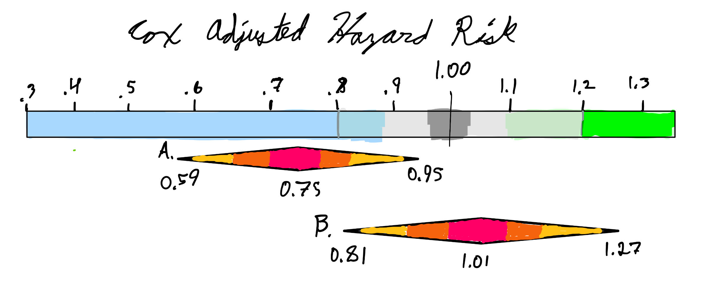

#+TITLE: Part 2
#+AUTHOR: Ben Heinze
#+DATE: 2026-10-13
#+STARTUP: noindent

#+MACRO: hl @@html:$2@@@@latex:\hl{$1}{$2}@@

# This is used to shrink the pdf page margins
#+LATEX_HEADER: \usepackage[left=0.75in,right=0.75in,top=1in,bottom=1in]{geometry}

# This is used to shrink the spacing between bullet points
#+LATEX_HEADER: \usepackage{enumitem}
#+LATEX_HEADER: \setlist[itemize]{itemsep=2pt, topsep=4pt}

The "baggage" that comes with power calculations (Higgs & Amrhein vs. Sleuth 23.4-23.5), a quantitative backdrop for the hazard-ratio intervals, and a hypothetical summary of statistical findings. Back to [[file:../index.org][Final Project]].

PDFs on this page:

- [[file:part2-submission.pdf][Part 2 submission]]
- [[file:higgs-amrhein-2025-giving-less-power-to-statistical-power.pdf][Higgs & Amrhein (2025), Giving Less Power to Statistical Power]]

* Question 1

Higgs and Amrhein warn about the blind over-reliance researchers have on power calculations when determining an appropriate sample size for a study.
In this paper, the authors explain how the concept of power is based on a collection of many decisions, which commonly need multiple repeated studies to derive.
Error rates are a part of this collection of decisions, and for many novel papers, it may be completely unreasonable to assume power calculations perfectly fit the context of the sought-after research.
This is where the "baggage" discussed by Higgs and Amrhein and in the Sleuth come in. Higgs and Amrhein refer to how Type I and Type II error are intertwined with statistical power, which are calculated with long-run rates from hypothetical study designs that are often not available, which is why statisticians must absorb as much context as possible into the study design to attempt to make up for this imprecision. This idea is highlighted in The Sleuth by referencing "practical significance". The Sleuth underscores the importance of study design when interpreting results, which parallels the concept from Higgs and Amrhein. These features include analyzing/accounting for covariates, randomization, blocking, and many other resources that aim to reduce the bias in sample averages as much as possible.
This extra caution attempts to increase precision and efficiency when selecting sample sizes for research summaries, making sure no test subject goes to waste.

#+LATEX: \newpage
* Question 2

#+CAPTION: Quantitative backdrop for visualizing the confidence intervals for the adjusted Cox hazard risk model for predicting the likelihood of being diagnosed with Alzheimer's disease and related dementias (ADRD) after completing the /speed/ intervention arm with a booster (interval A) and without a booster (interval B) relative to the likelihood of being diagnosed with ADRD with no cognitive intervention after a 20-year long follow-up. Since this metric is relative to the baseline, we attribute 1.00 as the null hypothesis that there is no evidence for a change in likelihood of being diagnosed with ADRD. The blue region represents strong evidence that there may be a lower likelihood of being diagnosed with ADRD for the given treatments. The green region represents strong evidence that there may be a higher likelihood of being diagnosed with ADRD for the given treatments. The gray region represents the boundaries in which the change in likelihood of being diagnosed with ADRD relative to the baseline is deemed too small to be considered a valuable difference.  Interval A represents the hazard risk interval for the speed-intervention arm who were given booster sessions (HR: 0.75 95%CI: 0.59, 0.95) relative to the group who had no cognitive intervention. Interval B represents the hazard risk interval for participants in the speed-intervention arm who were not given the booster sessions (HR: 1.01 95%CI: 0.81, 1.27) relative to the group who had no cognitive intervention. To remove the rigid limit of the confidence intervals, we define values closer to the point-estimate as more compatible with our findings, and values further from the point-estimate as less compatible with our findings. This paper used another paper's power calculation, "ACTIVE: A Cognitive Intervention Trial to Promote Independence in Older Adults", which used a range of 0.20 as their definition of an effective treatment. 

#+LATEX: \newpage
* Question 3

For 65+ year old patients recruited between March 1998 and October 1999 with Medicare who reside in one of the six metropolitan areas (Pennsylvania State University, Indiana University, Hebrew Rehabilitation Center for the Aged, Johns Hopkins University, Wayne State University, and University of Alabama) who do not have any of the following concerns: significant cognitive dysfunction (MMSE score < 23), functional impairment, self- reported diagnosis of Alzheimer's, a stroke within the last 12 months, certain cancers, and those who are undergoing chemotherapy/radiation therapy, there is strong evidence that there is a lower hazard risk for patients who participated in the speed-intervention arm that were given booster sessions compared to those who did not perform in any intervention arms (Cox hazard risk: 0.75, 95% CI: 0.59-0.95). Results closer to 0.75 are more compatible with the researcher's model, while results closer to the interval's boundaries are less compatible with the researcher's model. Since this study conducted a random assignment for the intervention arm and the booster sessions, this study accounted for the confounding variables which provides strong evidence that there is a causal relationship between cognitive intervention arm and reduced likelihood of being diagnosed with ADRD. Researchers took note of possible covariates, and adjusted the intervals accordingly.

* Documents

** Part 2 submission

#+begin_export html
<embed src="part2-submission.pdf" width="100%" height="800px" type="application/pdf">
#+end_export

** Higgs & Amrhein (2025), Giving Less Power to Statistical Power

#+begin_export html
<embed src="higgs-amrhein-2025-giving-less-power-to-statistical-power.pdf" width="100%" height="800px" type="application/pdf">
#+end_export
