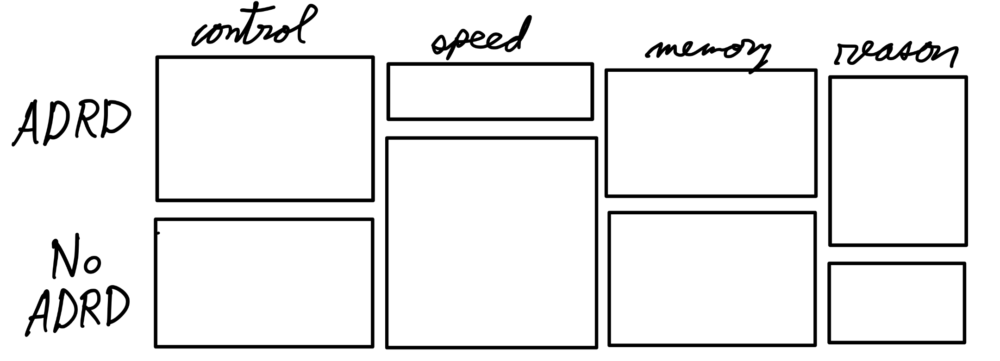

#+TITLE: Part 3
#+AUTHOR: Ben Heinze
#+DATE: 2026-10-13
#+STARTUP: noindent

#+MACRO: hl @@html:$2@@@@latex:\hl{$1}{$2}@@

# This is used to shrink the pdf page margins
#+LATEX_HEADER: \usepackage[left=0.75in,right=0.75in,top=1in,bottom=1in]{geometry}

# This is used to shrink the spacing between bullet points
#+LATEX_HEADER: \usepackage{enumitem}
#+LATEX_HEADER: \setlist[itemize]{itemsep=2pt, topsep=4pt}

The final analysis-plan report (dated April 27, 2026): study design, a proposed logistic-regression model, the quantitative backdrop, hypothetical results, scope of inference, and conclusion. Back to [[file:../index.org][Final Project]].

PDFs on this page:

- [[file:final_report.pdf][Final report]]
- [[file:part1Feedback.pdf][Instructor feedback on Part 1]]
- [[file:part2Feedback.pdf][Instructor feedback on Part 2]]

* Introduction

Alzheimer's disease and related dementias (ADRD) is an increasingly common issue as the neurological decline persists heavily in older adults.
This set of diseases can take years to progress, which makes it difficult to conduct a long-term study.
This paper, "Impact of cognitive training on claims-based diagnosed dementia over 20 years: evidence from the ACTIVE study" by Coe et. al. aimed to address this issue by linking previous data gathered from the Advanced Cognitive Training for Independent and Vital Eldery (ACTIVE) dataset with Medicare claims data to create a 20-year follow up period to analyze; 2021 out of the original 2802 were eligible for the 20-year follow-up analysis. Medicare is the United State's federal health insurance program for people over the age of 65.
The researchers randomized the participants into four cognitive training interventions after each participant's baseline data was measured: memory-based, speed-based, reasoning-based, and a control group where no intervention was implemented.
If the subject completed eight of the 10 initial training sessions, they had a random chance to be assigned an additional "booster" sessions that took place 11 and 35 months after baseline.
Researchers aimed to determine whether cognitive training interventions impacted the likelihood of being diagnosed with ADRD in susceptible patients, and if so, discover which approach is most effective, after a 20-year follow-up.

* Methods

** Field Methods/Study Design

*** Study Design

In an attempt to determine whether cognitive training intervention has an impact on the likelihood of an ADRD diagnosis, the original ACTIVE study recruited eligible subjects from six metropolitan areas (Pennsylvania State University, Indiana University, Hebrew Rehabilitation Center for the Aged, Johns Hopkins University, Wayne State University, and University of Alabama) between March 1998 and October 1999.
These participants were required to be 65+ years old, and pass a list of exclusion criterion.
5000 people were assessed to be recruited in the study and 2802 of them were eligible; the participants were not selected randomly. The demographics consisted of a 26% minority, 76% female, with 13.7 year of average schooling, and 73.6 years old on average.
The eligible participants were tested for baseline.
Next, they were randomized into one of the four intervention arms: memory, speed, reasoning, and control.
Patients who completed eight out of 10 training sessions were eligible for the booster addition, and which group a patient was assigned to (booster, no booster) was randomized as well, with the exception of the controlled intervention group.
Acumen's matching algorithm matched 71% of the original participants from the ACTIVE study to the Medicare claims data by matching social security numbers, date of births, and gender, after excluding 725 participants who enrolled in Medicare Advantage due to incomplete data, eight participants who passed away, and nine participants who were diagnosed with ADRD upon entering ACTIVE.

#+CAPTION: Graphical representation of ACTIVE dataset Study Design.
#+NAME: fig:concept_diagaram
#+ATTR_LATEX: :width 0.7\linewidth :center t
file:study_design.png	

This study had a control group where no intervention was used, which also means the participants had no opportunity to recieve booster training sessions.
This was a single-blind study where the staff who overlooked the cognitive training and questionnaires were not provided information on which group the subject was assigned to.
Due to the number of possible confounding variables in a medical environment, this study contained a strict criteria for enrollment in an attempt to minimize potential external factors that could effect the results of this study.
This list filtered out people with pre-existing significant cognitive dysfunction, functional impairment, self-reported diagnosis, people who experienced a stroke within the last 12 months, specific cancers, and people who were undergoing chemotherapy or radiation therapy.

This study randomized participants into one of the four intervention arms and booster sessions for eligible participants.
The experimental units are the 65+ year old people.
The population of interest is the people who are prone to being diagnosed with an ADRD.
The system of study is explained by how ADRD is set of neurological diseases that impact cognitive abilities in older adults.
Since ADRD affects cognitive ability, researchers hypothesize that the progression of the disease may be combatted by increasing brain stimulation via cognitive training.

The response variable is the likelihood of being diagnosed with ADRD, which is calculated with a cause-specific Cox proportional hazard model. A Cox proportional hazard model is a statistical tool used to estimate the rate of a specific event occuring over time. In the context of this study, the Cox proportional hazard model is estimating the rate of being diagnosed with ADRD over time. These hazard risks (HRs) are reported relative to the baseline, so if the likelihood of being diagnosed with ADRD remains unchanged after being calculated 20-years later, then the ratio would be 1.00. If the likelihood increases or decreases over time, then the results will be greater than 1 or less than 1 respectively.
The intervention arm treatment and the booster are varied across the participants.
**Frame for logistic Regression?**

#+CAPTION: Conceptual diagram of factors that may effect the likelihood of an ADRD diagnosis
#+ATTR_LATEX: :width 0.7\linewidth :center t
file:diagram.png

Confounding variables to be controlled by analysis (covariates) are the pre-specified patient characteristics described in the diagram above: age, sex, race, marital status, years of education, and vascular risk (vascular risk is associated with a higher likelihood of ADRD diagnosis). Every eligible subject was properly randomized to control confounding variables within the types of people and the type of intervention.
The outline of statistical analysis has sites (six levels), patients have the type of intervention arm (four levels), then the booster sessions (two levels). The interaction between the intervention arm and the booster sessions will be included.

*** Research Question

The research question for this academic paper wonders if intervention via cognitive training effects the likelihood (hazard risk) of being diagnosed with ADRD over a 20-year follow-up time frame. 
The authors of this paper conducted this research with a modified cause-specific Cox proportional hazard model which reported the odds of being diagnosed with ADRD.
The theoretical model would contain the hazard rate adjusted for covariates as the response variable, and the intervetion arm, and the booster as the explanatory variables. 
Other factors such as age and number of years of education may be added.
Performing a step-wise variable selection may benefit our model.
They have a very large sample group that was randomly assigned to intervention.
If the patients performed the training for long enough, they were allowed to be assigned booster sessions, which was also randomized.
Instead of actively following up with the patients, they used the past ACTIVE study and synced it to Medicare data to increase the length of this study.
It is worth noting that they excluded patients with Medicare Advantage, which is offered by private companies and contains additional benefits to Medicare. This is worth noting because it suggests that participants in this may represent a lower socioeconomic population, but this paper does not further investigate this potential marginalization, which could effect the scope of inference. Despite this trials best intentions, the 76% of the participants wwere female, and 71% were white. This data is unbalanced towards female participants and white participants, and the study adjusted this as a covariate.

** Proposed Statistical Procedure

The researchers opted for a cause-specific Cox proportional hazard model. However, in my hypothetical proposed theoretical model, a generalized linear model with a binary reponses will be sufficient.
First, the reponse is binary, so it follows a Bernoulli distribution, where the reponse Y is a "success" if the participant is diagnosed with ADRD by the end of the trial, and 0 otherwise.
\[ Y \sim \text{Bernoulli}(\pi), \text{where } P(Y=1) = \pi \]
\[
Y = \begin{cases} 1 & \text{if participant is diagnosed with ADRD by last follow-up} \\ 0 & \text{otherwise} \end{cases}
\]

Next, since this is a logistic regression, the link function will be the logit of pi:
\[ logit(\pi) = log \left( \frac{\pi}{1-\pi} \right) = \omega \]

The mean and the variance for $Y$ is:

\[ \mu_{\pi} = \pi, \text{VAR}_{y} = \pi(1-\pi) \]

Here is the linear predictor, which includes the four cognitive intervention arms, and the booster indicators.
\[ logit(\pi) = \beta_0 + \beta_1 I_{arm = speed} + \beta_2 I_{arm = memory} + \beta_3 I_{arm=reasoning} + \beta_4 I_{booster} + \beta_6 I_{j} + \ldots + \beta_{10} I_{J}\] 

Where $j = 1, \ldots, 5$ for the six different location sites.

Parameters:
- $\beta_0$: The baseline paramter for whether a participant is diagnosed with ADRD and did not take any intervention arm, did not participate in booster sessions, were located in the first first site: Pennsylvania State University, where the age is 0. 
- $\beta_1 - \beta_3$: The parameters associated with the three other cognitive training arms. 
- $\beta_4$: The parameter associated with whether booster sessions were perscribed. 
- $\beta_5$: The parameter associated with age.
- $\beta_6 - \beta_{10}$: Parameters associated with the other five sites: Indiana University, Hebrew Rehabilitation Center for the Aged, Johns Hopkins University, Wayne State University, and University of Alabama.

I would choose a simple mosiac plot for exploratory analysis, there would be two rows to signify whether the patient was diagnosed with ADRD or not, and each column would represent the different intervention methods. In this plot, I would look at the ratio of "diagnosed"/"not diagnosed".

#+ATTR_LATEX: :placement [H]
#+CAPTION: Sketch of a mosaic plot for the different cognitive intervention arms.
#+NAME: fig:mosaic
#+ATTR_LATEX: :width 0.7\linewidth :center t

For plans of refinement include:
- Fit the data to the logistic regression model.
- Use a step-wise variable selection to assess potential important variables.
- Test for an interaction between intervention arm and booster.
- Create the diagnostic plots and assess the assumptions.
  
** Quantitative Backdrop

Figure [[fig:backdrop]] shows the adjusted hazard risk confidence intervals for the speed cognitive training intervention arm with booster intervention sessions (interval A), and the speed cognitive intervention arm without booster intervention sessions (interval B). This these confidence intervals were the ones found in the research paper, this is not from the hypothetical logistic regression model.
Since this metric is relative to the baseline, we attribute 1.00 as the null hypothesis that there is no evidence for a change in likelihood of being diagnosed with ADRD. This paper referenced a previous paper for their power calculations, which determined that the minimal distinction between effectiveness from the baseline is 0.20% from the baseline with 95% confidence. This calculate took into consideration the assumptions of six Bonferroni-corrected two-sided comparisons, and added margins for the sample size in order to account for participants not finishing the experiment.
The blue region represents strong evidence that there may be a lower likelihood of being diagnosed with ADRD for the given treatments.
The green region represents strong evidence that there may be a higher likelihood of being diagnosed with ADRD for the given treatments.
The gray region represents the boundaries in which the change in likelihood of being diagnosed with ADRD relative to the baseline is deemed too small to be considered a valuable difference.

#+CAPTION: Quantitative backdrop for visualizing the confidence intervals for the adjusted Cox hazard risk model for predicting the likelihood of being diagnosed with ADRD after completing the speed intervention arm with a booster (interval A) and without a booster (interval B) relative to the likelihood of being diagnosed with ADRD with no cognitive intervention after a 20-year long follow-up. 
#+NAME: fig:backdrop
#+ATTR_LATEX: :width 0.8\linewidth :center t
[[file:quantitative_backdrop.jpg]]

Interval A represents the hazard risk interval for the speed-intervention arm who were given booster sessions (HR: 0.75 95%CI: 0.59, 0.95) relative to the group who had no cognitive intervention.
Interval B represents the hazard risk interval for participants in the speed-intervention arm who were not given the booster sessions (HR: 1.01 95%CI: 0.81, 1.27) relative to the group who had no cognitive intervention.
To remove the rigid limit of the confidence intervals, we define values closer to the point-estimate as more compatible with our findings, and values further from the point-estimate as less compatible with our findings.

* Hypothetical Results/Summary of Statistical Findings 

** Communication

To test for an interaction between the cognitive intervention arms and booster sessions, we can use a type 1 ANOVA test. Let us assume that there is strong evidence that there is an interaction between the speed cognitive training intervention and the use of booster sessions (F = high, p-value < very small).

Once the model is ready, the Wald-based confidence interval for each $\hat{\beta}_i$, then we can convert it to the odds scale for interpretation: We are 95% confident that there is  (95% CI:lowerbound, upperbound)

\[ \beta_1 \pm 1.96 SE \left( \hat{\beta_1} \right) = (exp\{\text{lowerbound}\}, exp\{\text{upperbound}\}) = (\text{loweround, upperbound}) \]

It is estimated that the speed cognitive training intervention relative to baseline lies between /lowerbound/ and /upperbound/ on the odds scale, after accounting for booster sessions (95%CI: (lowerbound, upperbound),  Z= high, p-value = small).

** Visualization

Since we are using a logistic regression GLM to hypothetically model the odds of developing ADRD after the 20-year follow-up for each intervention arm and booster status, we have a few choices for visualizing the results. In this scenario, tableplots would provide the most information in a single plot. We can use it to visualize the odds for each intervention with and without booster, sex, age, and even location site. Figure [[fig:visualization]] shows just a few of the possible table plots.

#+ATTR_LATEX: :placement [H]
#+NAME: fig:visualization
#+ATTR_LATEX: :width 0.5\linewidth :center t
#+CAPTION: Illustration of what a tableplot for the impact of the speed cognitive trainings with and without booster sessions, and sex of the participant on odds of ADRD diagnosis.
file:visualization.jpg

To visualize whether there is an interaction between the speed cognitive training intervention and booster sessions, we can use an effects plot, as shown in figure [[fig:effects]].

#+ATTR_LATEX: :placement [H]
#+NAME: fig:effects
#+ATTR_LATEX: :width 0.5\linewidth :center t
#+CAPTION: Illustration of effects plot to visualize the interaction between the speed cognitive training intervention and booster sessions.
file:effects.jpg

* Scope of Inference

For 65+ year old patients recruited between March 1998 and October 1999 with Medicare who reside in one of the six metropolitan areas (Pennsylvania State University, Indiana University, Hebrew Rehabilitation Center for the Aged, Johns Hopkins University, Wayne State University, and University of Alabama) who do not have any of the following concerns: significant cognitive dysfunction (MMSE score < 23), functional impairment, self- reported diagnosis of Alzheimer's, a stroke within the last 12 months, certain cancers, and those who are undergoing chemotherapy/radiation therapy, there is strong evidence that there is a lower hazard risk for patients who participated in the speed-intervention arm that were given booster sessions compared to those who did not perform in any intervention arms (Cox hazard risk: 0.75, 95% CI: 0.59-0.95). Results closer to 0.75 are more compatible with the data, while results closer to the interval's boundaries are less compatible with the data. Since this study conducted a random assignment for the intervention arm and the booster sessions, this study accounted for the confounding variables which provides strong evidence that there is a causal relationship between cognitive intervention arm and reduced likelihood of being diagnosed with ADRD. Researchers took note of possible covariates, and adjusted the intervals accordingly.

* Conclusion

After analyzing the possible likelihood of being diagnosed with ADRD after the patients underwent either speed-related cognitive training intervention with a booster and without a booster, we can use the quantitative backdrop to interpret the results of our two intervals. In the context of the study, the point estimation for the speed-related cognitive training intervention arm with booster sessions is 0.75, which exceeds the study's definition of an effective difference between baseline (0.20%). This signifies that intervening ADRD-prone participants with speed-related cognitive training sessions and booster sessions may lower the likelihood of being diagnosed with ADRD by between 5-59%, where the 25% deduction is most compatible with the data, and results around 5% and 59% are less compatible with the data. Possible future work for this study include normalizing the data to better represent the underrepresented classes of participants, expanding the scope past one Medicare, and identifying trends and differences between site locations. This study contained 76% females, and 26% minority race, so attempting to gain additional information for the underrepesented groups could teach us more about the effects of likelihood of being diagnosed with ADRD. Furthermore, this paper only touched on the base-form of Medicare and excluded other insurance plans, including Medicare Advantage, which may correlate with higher wage. It would be interesting to see how these potentially higher-earning individuals compare with Medicare claims data on the likelihood of being diagnosed with ADRD. Finally, this project only analyzed six locations where five out of six of them were universities. Further research could broaden this scope to develop a more accurate depiction of the average population of people, rather than the convenience of this study.

* Documents

** Final report

#+begin_export html
<embed src="final_report.pdf" width="100%" height="800px" type="application/pdf">
#+end_export

** Instructor feedback on Part 1

#+begin_export html
<embed src="part1Feedback.pdf" width="100%" height="800px" type="application/pdf">
#+end_export

** Instructor feedback on Part 2

#+begin_export html
<embed src="part2Feedback.pdf" width="100%" height="800px" type="application/pdf">
#+end_export
