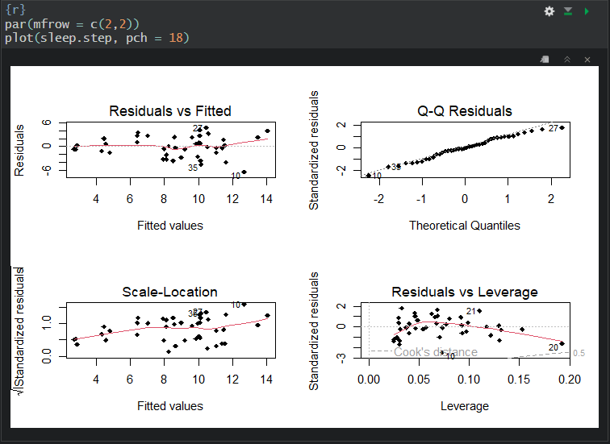

#+TITLE: Homework 2 Part I
#+AUTHOR: Ben Heinze
#+DATE: 2026-10-13
#+STARTUP: noindent
#+PROPERTY: header-args:R :session *stat512* :results output :exports code

#+MACRO: hl @@html:$2@@@@latex:\hl{$1}{$2}@@

# This is used to shrink the pdf page margins
#+LATEX_HEADER: \usepackage[left=0.75in,right=0.75in,top=1in,bottom=1in]{geometry}

# This is used to shrink the spacing between bullet points
#+LATEX_HEADER: \usepackage{enumitem}
#+LATEX_HEADER: \setlist[itemize]{itemsep=2pt, topsep=4pt}

Part I: variable selection. The poem /The Blind Men and the Elephant/, then a critique of the stepwise selection in Allison & Cicchetti (1976). =mammalsleep.csv= is kept alongside this page. Back to [[file:index.org][Homework 2]].

PDFs on this page:

- [[file:hw2-part1-handout.pdf][Part I handout]]
- [[file:hw2-part1-submission.pdf][Part I submission]]
- [[file:allison-cicchetti-1976-sleep-in-mammals.pdf][Allison & Cicchetti (1976), Sleep in Mammals]]

/STAT X12: Homework 2/

Author(s): Ben Heinze Due: Friday, 2/13, 5pm

#+NAME: setup
#+begin_src R

# load packages
library(faraway)
library(tidyverse)
library(GGally)
library(dplyr)
knitr::opts_chunk$set(echo = FALSE, 
                      warning = FALSE, message = FALSE)
options(show.signif.stars = FALSE)

data(mammalsleep)
#+end_src

* Part I - Variable Selection (can be turned in individually)

*Instructions:* */Group work is encouraged, but is not necessary for this part of the assignment/*. Please either work on your own to complete this part of the assignment or with a group of no more than 4 students. Please submit just one assignment per group and associate the names of all contributing group members with your assignment in GS.

1. You should have already read Chapter 12 in the Sleuth. Work through the conceptual exercises to assess your understanding (answers provided in the text). Also read /The Blind Men and the Elephant/ (posted on Brightspace), and provide an interpretation of the poem that relates to model selection techniques we have recently discussed. You will receive full credit for providing a thoughtful and coherent response that is /in your own words/ (i.e., please do not use LLMs for this problem, I want your thoughts!).

*The poem discusses six blind men who each observe a fraction an elephant, then immediately form conclusions based on what they individually perceive. However, only looking at a piece of the whole picture is not enough to form reliable conclusions. The six blind men discard each others truths as if everyone else was wrong. In reality, everyone has a partial truth that could been combined to properly interpret the elephant. When we create a model off of data, we need to understand that the variables alone are just a fraction of the whole picture. We need to see how the elephants, trunk, ear, tusk are related to each other, similarly to how variable selection tries to choose the most informative variables and how they interact with each other in a model. While it may not be perfect, broadening our scope to include other variables and how they interact can greatly effect how well our model aligns with the truth.*

Read this article, /Sleep in Mammals: Ecological and Constitutional Correlates" by Allison, T. and Cicchetti, D. (1976), Science, November 12, vol. 194, pp. 732-734/ (posted Canvas). The Principle components analysis (PCA) discussed in the article is a dimension reduction technique that you can learn more about in an\_ /Introduction to Statistical Learning/ (text referenced in Ch12 slides or STAT 437). Focus on the VS sections of the paper and answer the following questions about the article.

2. What type of variable selection did the authors use in this paper? Did they allow for interactions or higher order terms in their variable selection method? If it is not clear what they used, please state why.

*The authors used a stepwise variable selection model. I think they did not use interaction terms. Even though they construct factor variables from PCA, they do not explicitly state they looked for interactions between variables for the variable selection process. They only state, "the constitutional and ecological measure were predictor (independent) variables".*

3. Which objective (1,2, or 3 as discussed in course notes) do you think the variable selection was used for?

*I would say object 2: fishing for an explanation best fits this paper's application of variable selection, since they are trying to find the variables that best predict sleep variables. It is not objective 1: adjusting because we aren't forcing an X variable of interest in the model, and it's not objective 3: prediction because we aren't selecting multiple models or averaging other them.*

4. The authors state, "To determine the variables that predict sleep variability, we carried out stepwise multiple regression analysis in which SWS or PS were predicted (dependent) variables and the constitutional and ecological measures were predictors (independent) variables." In what ways could the use of the word "determine" be misleading in this context?

*The word "determine" in that sentence suggests that there is only one correct answer. In reality, there can be several combinations of variables that predict sleep variability, some may be better or worse than the method they implemented.*

5. The authors present their top model for SWS as (1) in the paper. It is missing an important piece of notation. Correct the notation and report the estimated top model for SWS.

*I think the notation they missed was the hat over the SWS and the use of the equal sign. This notation suggests that it's a population model and not an estimation model.*

$$\hat{\mu} \{\text{SWS} \mid \text{body weight, overall danger}\} = 11.7 - (1.82 \pm 0.37)log(w_b)- (0.700 \pm 0.33)D$$

$$\hat{\mu} \{\text{SWS} \mid \text{body weight, overall danger}\} \sim  \mathcal{N}(0, \sigma^2)$$

6. Summarize the authors discussion of their findings with respect to the variables in the top model when the response is slow-wave "nondreaming" sleep (SWS). In your summary mention if the paper fell victim to the temptation to conduct hypothesis tests or make strong inferences for variables were already investigated with a VS technique.

*The authors say there is a negative correlation between SWS and body weight, and that brain weight is equally as good, and any biological variable may have high correlation with SWS. They also say metabolic rate may be highly correlated too, but they lacked enough data to confirm it. They then speculate whether large animals would even benefit from SWS since some of them are strictly herbivores which has higher chances for predation. The paper mentions body weight in the in the MLR, then discusses other variables such as brain weight and Basal metabolic rate, but they did not use any hypothesis testing for these.*

The data associated with the paper are provided in the ~faraway~ package (Faraway J, 2022). The code chunk below will read these data in and do some data cleaning for you so that you can investigate some of the decisions the authors made and compare your own analysis of these data to theirs.

#+begin_src R
# make some transformations made by authors and reclass string variables 
# to factors. 
# remove rows with incomplete cases --- note this assumes the values were 
# missing at random and there is no association between "missingness" and 
# the outcome of the response variable. 
sleep_df <- mammalsleep |> 
  mutate(exposure_level = factor(ifelse(exposure == 1, "Low", "High")), 
         predation_c = factor(predation), # top two vars for Part II of HW
         PS = dream, # rename to match paper
         log_PS = log(dream + 0.05), # add 0.05 to all PS sleep times 
          # to include mammal with 0 PS in analysis on log_PS scale
         SWS = nondream, # rename to match paper
         lgest = log(gestation), # log transformations from paper
         lbrain = log(brain), 
         lbody = log(body)) %>% 
  drop_na() # remove mammals with NAs in any of the rows of the data frame 

# create a data frame for part I analyses
df_sleep <- sleep_df %>% 
  dplyr::select(body, lbody, brain, lbrain, gestation, lgest, lifespan, 
         predation, exposure, danger, sleep, PS, log_PS, SWS) 
#+end_src

7. Create a pairs plot of the ~df_sleep~ dataset and use it to explain why you think the paper used log-transformed variables for gestation length, body size, and brain size. Be sure to reference specific sub-plots within the pairs plot to answer this question.

#+begin_src R
# I'm assuming the prompt wants brain weight instead of brain size
df_sleep |> select(gestation, body, brain, SWS) |>
  GGally::ggpairs()
#+end_src

*The paper used a log transform on body size, gestation length, and brain weight because they all show a non-linear relationship with SWS. The log-transform was the authors attempt to linearize the data. Body weight and brain weight are the most severe cases, where most of the data points are crammed between 0-500 units, then then body weight and brain weight have outliers around 2500 units and 4500 units respectively. The scatterplot between gestation and SWS's curve is much more gentle compared to the other two variables.*

8. Write code to run the ~step~ function to conduct forward selection with ~SWS~ as the response variable of interest and AIC as the model-selection criterion. Use ~SWS ~ 1~ as the starting model and a ~scope~ that includes all first order terms ~(SWS ~ lbody + lbrain + lgest + lifespan + predation + exposure + danger)~. Include the output in your response to this question.

#+begin_src R
sleep.step <- step(lm(SWS ~ 1,
                      data = df_sleep),
                     scope = SWS ~ lbody + lbrain + 
                     lgest + lifespan + predation + 
                     exposure + danger,
                     direction = "forward")
 summary(sleep.step)
#+end_src

$$\mu\{SWS \mid \text{lbody, danger}\} = 11.8968 - 0.6766 \text{ lbody} - 0.9701\text{ danger}$$

9. How do your results compare to the results presented in the paper? (i.e., How are they similar? How are they different?) What assumptions did you have to make about the analysis in the paper that could potentially explain any differences you observed in your analysis? /(max 1/4 page single-spaced)/

*The forward step function using AIC as the criterion identified the same variables used in the paper. The intercept is roughly the same and the danger estimate calculated falls within the range of the paper's range. The log body estimate is very different. The paper estimated a range of 1.45-2.19 which is over two-three times greater than R's estimated 0.67. This may be explained by whether log-transforming body weight actually linearized the data or not.*

10. Create a suite of diagnostic plots for the top model you found in 6. Assess each linear model assumption you can investigate using the plots and identify any severe violations. Be sure to reference specific features of specific plots in your response.

#+begin_src R
par(mfrow = c(2,2))
plot(sleep.step, pch = 18)
#+end_src

*Without knowing how the dataset was collected, we cannot determine evidence against independence. The Residuals vs Fitted plot shows no evidence against linearity. The Residuals vs Fitted plot overall shows moderate evidence against constant variance since the residuals tend to "fan out" and spread as the fitted values increase. The Q-Q Residuals plot shows weak evidence against normality since the vast majority of points closely follow the line of normality. The Residuals vs Leverage plot does not have any points falling outside of Cook's distance values greater than 0.5, despite some points having higher leverage values, so we have weak evidence against the assumption of no influential points.*

* References

Faraway J. (2022). /faraway: Functions and Datasets for Books by Julian Faraway/. R package version 1.0.8, [[https://CRAN.R-project.org/package=faraway]]

* Documents

** Part I handout

#+begin_export html
<embed src="hw2-part1-handout.pdf" width="100%" height="800px" type="application/pdf">
#+end_export

** Part I submission

#+begin_export html
<embed src="hw2-part1-submission.pdf" width="100%" height="800px" type="application/pdf">
#+end_export

** Allison & Cicchetti (1976), Sleep in Mammals

#+begin_export html
<embed src="allison-cicchetti-1976-sleep-in-mammals.pdf" width="100%" height="800px" type="application/pdf">
#+end_export
