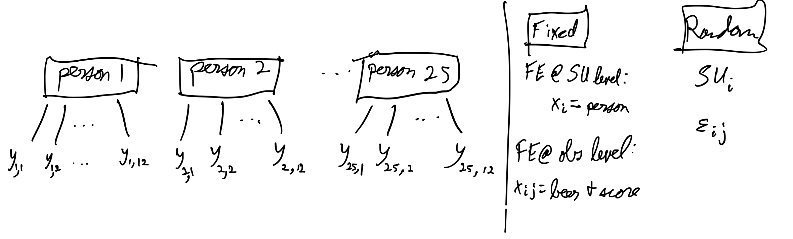
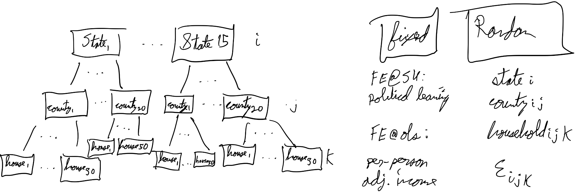

#+TITLE: Homework 3 Part I Answers
#+AUTHOR: Ben Heinze
#+DATE: 2026-10-13
#+STARTUP: noindent

#+MACRO: hl @@html:$2@@@@latex:\hl{$1}{$2}@@

# This is used to shrink the pdf page margins
#+LATEX_HEADER: \usepackage[left=0.75in,right=0.75in,top=1in,bottom=1in]{geometry}

# This is used to shrink the spacing between bullet points
#+LATEX_HEADER: \usepackage{enumitem}
#+LATEX_HEADER: \setlist[itemize]{itemsep=2pt, topsep=4pt}

My individual answers to Part I of [[file:index.org][Homework 3]]: measurement structure, model diagrams, and theoretical mixed models for two study descriptions. The hand-drawn diagrams are the photos below each question.

* Question 1.
Weight only needs the single subscript $i$ because that is going to remain constant through each sweat measurement, so they only need to account for it on the subject level. The no-tattoo indicator, on the other hand, will change despite the subject being the same, so this is on the observation level.

* Question 2.
If the classmate used $age_{ij}$ despite it being measured one per subject, at the observation level, /modeldiagramR/ uses data to generate a corrected model by creating a model diagram based on the data, which would make this student's mistake clearly visible. 

* Question 3.
I'd use the LearnVizLMM package to check the model diagram fro lab 7 before cleaning and wrangling the data because it doesn't require the data or a model object to draw the diagram.

* Question 4.1
Measurement structure:

- fixed effects column:
  - people @SU level ($x_i$)
  - Time they took quiz, liters of beer consumed @obs level ($x_{ij}$)
- random effects column: $SU_i$, $\epsilon_{ij}$
- i = 1-25 (index people)
- j = 1-12, (index observation within people (number of tests taken))

Theoretical model:

$\text{IQScore}_{ij} = \mu_{ij} + Person_{i} + \epsilon_{ij}$

$\mu_{ij} = \beta_0 + \beta_1 I_{test 2} + \ldots + \beta_{11} I_{test 12} + \beta_{13} \text{beer\_liters}$

$SU_{i} \sim \mathcal{N} (0, \sigma^2_{person})$

$\epsilon_{ij} \sim \mathcal{N} (0, \sigma^2)$

Model params: 
- $\beta_0$: expected IQ for someone who doesn't drink
- $\beta_i$ = the change in intercept for test i compared to baseline
- $\beta_{13}$ = the change in intercept compared to baseline given the liter of beer they drank in the last two weeks.
   

* Question 4.2

- i = 1-15 (index state)
- j = 1-20 (index county)
- k = 1-50 (index households)
Theoretical model:
$\text{diff}_{ijk} = \mu_{ijk} + state_i + county_{ij} + household_{ijk} + \epsilon_{ijk}$

$\text{Diff}_{ij} = \mu_{ijk} + State_{i} + county_{ij} + household_{ijk} + \epsilon_{ijk}$

$\mu_{ijk} = \beta_0 + \beta_1 \text{per person adj income} + \beta_2 I_{right\_leaning} + \beta_3 \text{youngest}$

$state_{i} \sim \mathcal{N} (0, \sigma^2_{state})$

$county_{ij} \sim \mathcal{N} (0, \sigma^2_{count})$

$household_{ijk} \sim \mathcal{N} (0, \sigma^2_{household})$

$\epsilon_{ij} \sim \mathcal{N} (0, \sigma^2)$

Model params:
- $\beta_0$: mean adjusted household income for left-leaning if youngest per-person-adj income is zero and youngest age in household is zero
- $\beta_1$: how the intercept changes with the inclusion of per-person-adjusted-income compared to baseline
- $\beta_2$: how the intercept of baseline changes based on whether the county was right-leaning or not
- $\beta_3$ how the intercept of baseline changes based on age of the youngest person in the household
